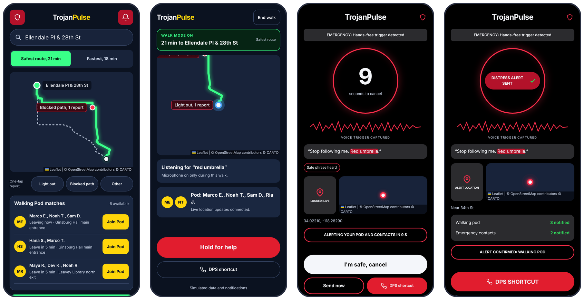
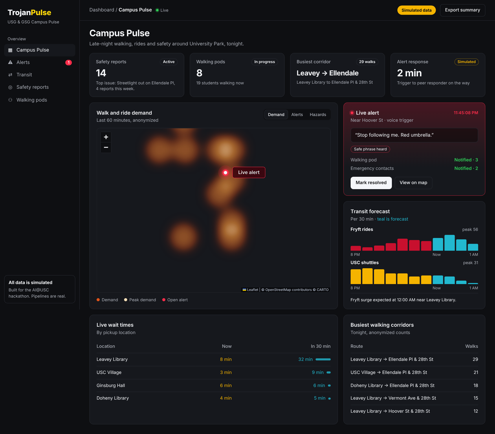
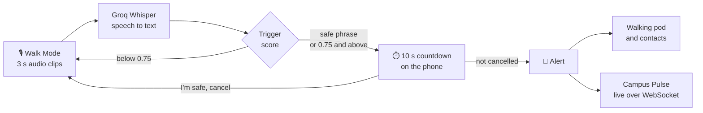

# TrojanPulse

**Start a walk, and you are never walking alone.** By Trojans For Trojans.

A voice-triggered safety net for students walking alone at USC, with walking pods, safer routes and a live campus dashboard. Built at the AI@USC hackathon, November 14 to 15, 2026.

<br/>

| | Link |
|---|---|
| **Live student app** | [trojan-pulse.replit.app](https://trojan-pulse.replit.app) |
| **Live Campus Pulse dashboard** | [trojan-pulse.replit.app/dashboard](https://trojan-pulse.replit.app/dashboard) |
| **Demo video** | [youtu.be/lXa7X5mqJLU](https://youtu.be/lXa7X5mqJLU) |
| **Technical documentation** | [technical-documentation.pdf](docs/technical-documentation.pdf) |

<br/>

      

## Screens

### Student app

For students walking alone: plan the safest route, join a walking pod, and send a hands-free alert by voice.



### Campus Pulse dashboard

For USG and GSG: live alerts, hazard reports, walk demand and a ride forecast for tonight.



## Why

Most safety tools ask for a free hand and a calm head at the exact moment a student has neither. And the people who could fix a dark street, such as student government, only hear about it later, if at all.

TrojanPulse covers both. A student starts a walk and keeps the phone in a pocket. If something goes wrong, saying one phrase is enough. Campus leaders see what is happening tonight on one screen.

## What it does

| | Feature | How it works |
| :-: | --- | --- |
| 🗺️ | **Safest or fastest route** | Both run on the real OpenStreetMap street graph. The safest route makes a street cost more where a light is out, an incident was recent, nothing is open nearby or few people walk. |
| 👥 | **Walking pods** | Students heading within 300 m of the same place, within 10 minutes of each other, are matched at a well-lit meeting point. Only first names and last initials are shared. |
| 🎙️ | **Hands-free voice trigger** | During a walk the phone sends 3 second audio clips for speech to text. Saying the safe phrase starts the alert. No tap needed. |
| ⏱️ | **10 second cancel** | Nothing leaves the phone until the countdown ends, so a false trigger costs one tap. |
| 🚨 | **Live alert** | The alert appears on the dashboard without a refresh, about a tenth of a second later in our tests, with the transcript and the nearest street. |
| 📍 | **One-tap hazard reports** | Light out, blocked path or other. Reports within 30 m are grouped and shown on every route map and on the dashboard. |
| 📞 | **DPS one tap away** | A call shortcut sits on every emergency screen. |

## How the voice trigger works



- **The safe phrase alone is enough.** It is matched word by word with a small tolerance, so "red umbrela" still counts and "blue umbrella" does not.
- **Other signals add up.** Distress phrases, a distress sound and a sudden stop are combined into one score. The app sends speech today. The endpoint already accepts the other two.
- **Phrases split across clips still match.** The last two transcripts are joined before scoring.
- **Privacy.** The microphone is on only during a walk. Audio is sent for transcription and is not stored by TrojanPulse.

## Campus Pulse

A dashboard for USG and GSG, the people who can act on what students report.

- **Live alerts** arrive without a refresh and can be resolved or shown on the map.
- **Demand map** with layers for demand, alerts and hazards. A map square needs at least 3 people before it shows, so no one can be picked out.
- **Transit forecast** from a scikit-learn model trained on three weeks of ride requests. It learns how crowds let out nearby move demand.
- **Hazard summaries** are one neutral sentence each, written by an LLM when a key is set, about infrastructure and never about people.

## Built with

| Layer | Tools |
| --- | --- |
| Student app and dashboard | React 18, TypeScript, Vite, Leaflet |
| API | FastAPI, Pydantic, WebSocket |
| Speech to text | Groq Whisper |
| Routing | OSMnx and NetworkX on the OpenStreetMap graph |
| Forecast | scikit-learn |
| Hosting | Replit, one server for the API and both web apps |

## What is real and what is simulated

| Real | Simulated for the hackathon |
| --- | --- |
| Street graph, routing and pod matching | Walkers, ride requests, hazard reports and incidents |
| Speech to text and trigger scoring | Notifications to the pod and emergency contacts |
| Forecast model and live WebSocket updates | Alert response time |

Sign-in checks the format of a USC email. It is not USC single sign-on. There is no DPS integration. When location is unavailable or far from campus, the app starts from Leavey Library and says so.

## Ready for a pilot

TrojanPulse is a working product, not a mockup. A student can sign in, plan a route, join a pod, walk, trigger an alert by voice and be seen on the dashboard, with one server hosting all of it.

What separates this build from a campus pilot is mostly data. Every dataset is read through one loader, and every service computes its result from what the loader returns. Replacing a simulated file with a real feed changes the loader, not the services, the API or the apps.

| Simulated today | Real source for a pilot | Work needed |
| --- | --- | --- |
| Hazard reports | Students, through the one-tap report | None. Already live in the app. |
| Walkers | Opt-in walks started in the app | Read the walks the API already holds. |
| Incidents | Published campus safety alert text | Feed it to the existing extraction step. |
| Streetlights, ride requests, schedule | Facilities, transit and calendar records | Loader only. The models retrain when the data changes. |

Beyond data, a pilot needs USC single sign-on and real delivery of pod and contact notifications. The full plan is in the [technical documentation](docs/technical-documentation.pdf).

## Run it

Backend (Python 3.9 or newer):

```bash
cd backend
python3 -m venv .venv && source .venv/bin/activate
pip install -r requirements.txt
python -m data.generate          # once: creates the simulated datasets
python -m uvicorn app.main:app --reload
```

Frontend (Node 18 or newer):

```bash
cd frontend
npm install
cp .env.example .env.local
npm run dev
```

| What | Where |
| --- | --- |
| Student app | http://localhost:5173 |
| Dashboard | http://localhost:5173/dashboard |
| API docs | http://localhost:8000/docs |

Two keys make it complete. Both have free tiers.

| Key | Where it goes | Without it |
| --- | --- | --- |
| `GROQ_API_KEY` | `.env` at the repo root, copied from `.env.example` | Speech to text is off |
| `VITE_CARTO_KEY` | `frontend/.env.local`, from https://carto.com/basemaps/apikey | Maps show no streets |

`http://localhost:8000/health` reports `"data": "ready"` and `"transcription": "groq"` when everything is in place. In the student app, allow location and microphone access.

## Deploy on Replit

One server hosts the API, the student app and the dashboard.

1. Import this repo from GitHub into Replit.
2. In Secrets, add `GROQ_API_KEY` and `VITE_CARTO_KEY`.
3. Publish as a **Reserved VM**. Walks and alerts are kept in memory, so the app needs one server that stays on.

| Setting | Value |
| --- | --- |
| Build command | `bash replit-build.sh` |
| Run command | `bash -c "cd backend && python -m uvicorn app.main:app --host 0.0.0.0 --port 5000"` |

The student app is at `/` and the dashboard at `/dashboard`.

## Project layout

```
backend/app      API, schemas, services
backend/data     street graph and simulated data generators
frontend/src     student app, dashboard, shared components
docs             design doc and team guides
```

## Team

| Member | Built |
| --- | --- |
| [Ria Jha](https://github.com/riajha-usc) | System architecture and API contract. The real-time voice trigger pipeline: audio intake, Groq Whisper integration, signal fusion and alerting. Integration of the ML and LLM services into the API, live WebSocket updates, tests and deployment. |
| [Soham Banerjee](https://github.com/Soham286) | Street graph, safest and fastest routing, pod matching, hazard grouping and LLM summaries, LLM incident extraction, demand forecast and the simulated datasets. |
| [Arin Paul](https://github.com/ArinPaul) | Campus Pulse dashboard, the shared map component, the typed API client and the WebSocket hook. |
| [Sharayu Nagre](https://github.com/sharayu-n) | Student app: walk planning, Walk Mode, audio capture, location sharing, the cancel countdown and the alert screens. |

Architecture, the AI pipeline, the API reference and the pilot plan are in the [technical documentation](docs/technical-documentation.pdf). The design doc and build guides are also in [`docs`](docs).
